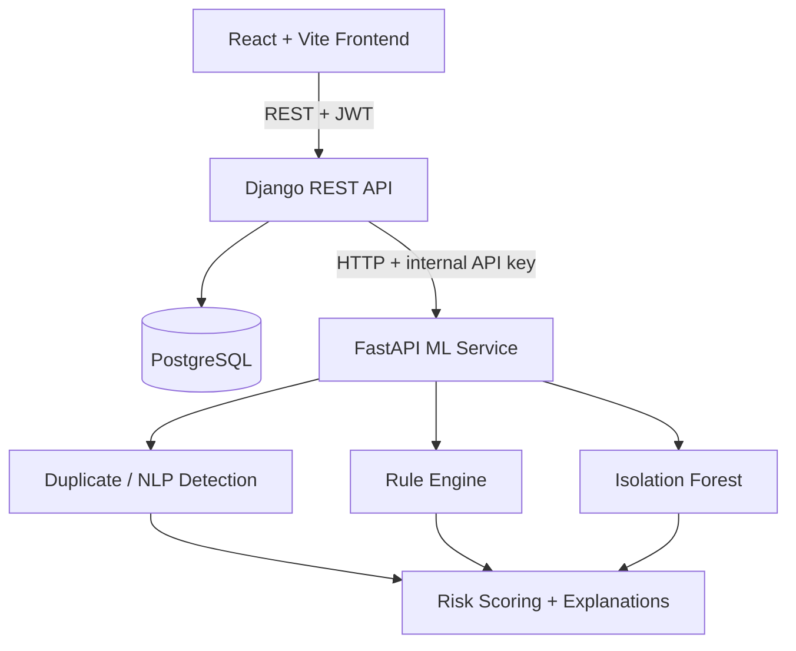

# Corporate Expense Fraud & Duplicate Invoice Intelligence Engine

An intelligent invoice-monitoring and decision-support platform that detects **possible duplicate invoices**, **unusual expense patterns**, **suspicious vendor activity** and other **risk indicators**. It assigns each invoice an explainable **0–100 risk score** and routes it to the right human reviewer.

> ⚠️ **This system does not decide that an invoice is fraudulent.** It surfaces *risk indicators* and explains them. A human reviewer always makes the final decision.

> 🎓 Academic project. All ML training data is **synthetic**. It does not represent real corporate fraud data.

**Status:** ✅ complete (all 17 phases, see [docs/development-plan.md](docs/development-plan.md)) · **622 automated tests passing** · on the synthetic hold-out the hybrid system sends 68% of injected anomalies to review at 40% precision (ML alone: 28%) · analysis of one invoice ≈ 80 ms.

---

## Table of Contents
- [Problem Statement](#problem-statement)
- [Objectives](#objectives)
- [Features](#features)
- [Architecture](#architecture)
- [Technology Stack](#technology-stack)
- [System Requirements](#system-requirements)
- [Installation](#installation)
- [Environment Variables](#environment-variables)
- [Database Setup](#database-setup)
- [Running the Services](#running-the-services)
- [Demo Data](#demo-data)
- [Results](#results)
- [API Documentation](#api-documentation)
- [ML Pipeline](#ml-pipeline)
- [Screenshots](#screenshots)
- [Testing](#testing)
- [Future Improvements](#future-improvements)
- [Limitations](#limitations)
- [Authors](#authors)

---

## Problem Statement
Organisations process thousands of vendor invoices. Duplicate payments (the same invoice paid twice, often with a slightly altered invoice number), split purchases that dodge approval limits, and payments redirected to changed bank accounts cause real financial loss. Manual review cannot check every invoice against every other one. Simple exact-match checks miss near-duplicates such as `INV-1001` vs `INV1001` vs `INV-100I`.

## Objectives
1. Detect near-duplicate invoices using fuzzy string matching (Levenshtein, Jaro-Winkler, token similarity).
2. Detect anomalies using a hybrid of **business rules** and an **Isolation Forest** model.
3. Combine all signals into an explainable **0–100 risk score** with human-readable reasons.
4. Route invoices to the right reviewer (auto / manager / auditor / blocked) based on risk.
5. Record every important action in a tamper-evident **audit log**.
6. Provide a professional dashboard, analytics and exportable reports.

## Features
- JWT authentication with 4 roles: **Admin, AP Officer, Manager, Auditor**. Every permission is checked on the backend.
- Vendor management with bank-account history (masked) and a vendor risk dashboard.
- Invoice creation, CSV/JSON bulk import, validation, search/filter/sort/pagination.
- Duplicate detection: a weighted similarity score over invoice number, vendor, amount, date and description.
- Rule-based detection: threshold proximity, split purchases, unusual submission time, round amounts, bank-account changes, amount and vendor anomalies.
- Isolation Forest anomaly detection on 13 engineered features.
- Explainable risk scoring with configurable weights, thresholds and escalation floors: every point is listed with its reason.
- Approval workflow: approve, reject, request clarification, escalate. Payments are simulated only.
- Fraud investigation page, in-app notifications, audit logs.
- Analytics (Recharts) and CSV/PDF reports.

## Architecture

Details: [docs/architecture.md](docs/architecture.md)

## Technology Stack
| Layer | Technology |
|---|---|
| Frontend | React, Vite, JavaScript, Tailwind CSS, Axios, React Router, Recharts |
| Main backend | Python, Django, Django REST Framework, SimpleJWT |
| Database | PostgreSQL 17 |
| ML service | FastAPI, Pydantic, scikit-learn, pandas, NumPy, RapidFuzz |
| Reports | reportlab (PDF), Python `csv` |
| Testing | Django test runner / pytest, FastAPI TestClient, Vitest |

## System Requirements
- Windows 10/11
- Python 3.11+
- Node.js 20+ and npm
- PostgreSQL 15+ (developed on 17)
- Git
- No Docker, WSL or Linux required

## Installation
Full step-by-step guide: [docs/installation.md](docs/installation.md)

## Environment Variables
Each service has its own `.env.example`. Copy it to `.env` and fill it in. **Never commit `.env`.** See [docs/installation.md](docs/installation.md#environment-variables).

## Database Setup
Create `backend\.env` from `backend\.env.example`, then let the script create the database user and database from it:
```powershell
powershell -ExecutionPolicy Bypass -File scripts\setup_database.ps1
cd backend; .env\Scripts\Activate.ps1; python manage.py migrate; python manage.py createsuperuser
```
Details: [docs/installation.md](docs/installation.md) §3–4 and [docs/database.md](docs/database.md).

## Running the Services
One command starts all three services in their own windows and opens the app when they are ready:
```powershell
powershell -ExecutionPolicy Bypass -File scripts\start_all.ps1
```
Or by hand, in three PowerShell windows:
```powershell
# 1) FastAPI -> http://127.0.0.1:8001  (Swagger at /docs)
cd ml-service; .env\Scripts\Activate.ps1; python -m uvicorn main:app --port 8001
```
```powershell
# 2) Django  -> http://127.0.0.1:8000
cd backend; .env\Scripts\Activate.ps1; python manage.py runserver 8000
```
```powershell
# 3) React   -> http://localhost:5173
cd frontend; npm run dev
```

## Demo Data
With the ML service running: `python manage.py seed_data` (in `backend`) creates the demo accounts `admin`, `ap_officer`, `manager`, `auditor` (password `Demo@12345`, **development only**), 8 fictional vendors, a year of invoice history and the five demo scenarios (normal, duplicate, unusual, split purchase, bank change), analysed by the real model. See [docs/installation.md](docs/installation.md) §8 and the walkthrough in [docs/user-guide.md](docs/user-guide.md).

## Results
Synthetic hold-out (1,772 invoices, 88 injected anomalies), “detected” = sent to human review ([docs/machine-learning.md](docs/machine-learning.md) §8):

| Detector | Precision | Recall | F1 |
|---|---|---|---|
| Isolation Forest only | 0.417 | 0.284 | 0.338 |
| Rules + duplicate detector only | 0.380 | 0.614 | 0.470 |
| **Hybrid system** | **0.400** | **0.682** | **0.504** |

Tests: Django 257 · ML service 199 · frontend 166, all passing; coverage 95% / 98% / 74% (Django 96% with the live tests). Performance and screenshots: [docs/project-report/13-results.md](docs/project-report/13-results.md).

## API Documentation
- Django REST endpoints: [docs/api.md](docs/api.md)
- FastAPI interactive Swagger: http://127.0.0.1:8001/docs

## ML Pipeline
Synthetic dataset → cleaning → feature engineering → scaling → Isolation Forest → evaluation → saved model → loaded once by FastAPI at startup.
See [docs/machine-learning.md](docs/machine-learning.md).

## Screenshots
| Screen | Image |
|---|---|
| Login | [INSERT SCREENSHOT] |
| Dashboard | [INSERT SCREENSHOT] |
| Invoice list | [INSERT SCREENSHOT] |
| Fraud investigation | [INSERT SCREENSHOT] |
| Approvals | [INSERT SCREENSHOT] |
| Analytics | [INSERT SCREENSHOT] |

## Testing
See [docs/testing.md](docs/testing.md). Everything at once:
```powershell
powershell -ExecutionPolicy Bypass -File scripts
un_tests.ps1          # add -Live for the 5 end-to-end tests
```
Or per part: `python manage.py test` (backend) · `python -m pytest` (ml-service) · `npm test` (frontend).

## Future Improvements
- Asynchronous analysis with Celery + Redis
- OCR invoice extraction from PDF/image uploads
- Supervised models once labelled review outcomes accumulate
- Email notifications and SSO

## Limitations
- The model is trained on synthetic data, so real-world performance is unknown.
- Risk scores are *indicators*, not fraud probabilities.
- The payment module is a simulation. No real money moves.

See [docs/project-report/14-limitations.md](docs/project-report/14-limitations.md).

## Authors
- [YOUR NAME] — [UNIVERSITY / PROGRAMME] — [YEAR]

## License
MIT. See [LICENSE](LICENSE).
