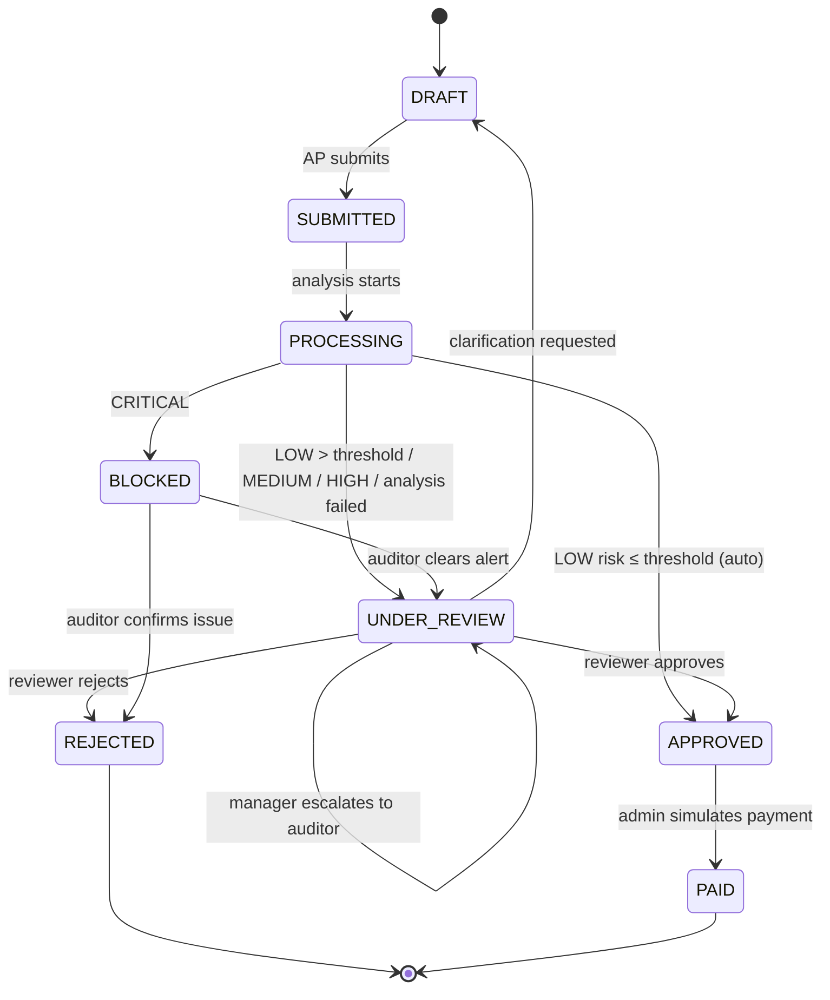

# Approval Workflow

> **Status:** ✅ Backend implemented and tested in Phase 9 (see §8). UI implemented in Phase 12 (frontend.md §10).

> 💡 **The payment module is a simulation for academic purposes. No real money is ever transferred.**

## 1. Invoice statuses
| Status | Meaning |
|---|---|
| `DRAFT` | Created, editable, not yet submitted (or returned for clarification) |
| `SUBMITTED` | Submitted by AP. Momentary state before processing |
| `PROCESSING` | Fraud analysis in progress |
| `UNDER_REVIEW` | Waiting for a Manager/Auditor decision |
| `APPROVED` | Approved. Ready for (simulated) payment |
| `REJECTED` | Rejected by a reviewer. Final |
| `BLOCKED` | Payment blocked because of critical risk. Under investigation |
| `PAID` | Simulated payment recorded. Final |

## 2. State diagram

Transitions are enforced in `invoices/services.py` through an `ALLOWED_TRANSITIONS` map. Anything else returns `409 INVALID_STATE_TRANSITION`.

## 3. Routing engine (`approvals/routing.py`)
Input: the invoice, the analysis result and the settings. Output: the next status plus zero or more `Approval` rows.

```text
if analysis failed
   or ML part skipped        → Approval(level=MANAGER);  UNDER_REVIEW   (fail safe, see risk-scoring.md §9.3)
elif level == CRITICAL       → BLOCKED; FraudAlert assigned to an auditor; Payment(status=BLOCKED)
elif level == HIGH           → Approval(level=AUDITOR);  UNDER_REVIEW
elif level == MEDIUM         → Approval(level=MANAGER);  UNDER_REVIEW
elif amount > threshold      → Approval(level=MANAGER);  UNDER_REVIEW     (Rule R1)
elif auto_approve_low_risk   → APPROVED (decided_by = system)
else                         → Approval(level=STANDARD); UNDER_REVIEW
```
**Assignee selection:** a Manager in the invoice's department with the fewest pending approvals. Otherwise any active Manager. For Auditor, the auditor with the fewest open alerts. This is a simple, explainable load balance.

## 4. Reviewer actions
| Action | Who | Comment required | Result |
|---|---|---|---|
| Approve | assigned Manager/Auditor | optional | Approval=APPROVED. Invoice → APPROVED |
| Reject | assigned | **yes** | Invoice → REJECTED. Submitter notified |
| Request clarification | assigned | **yes** | Invoice → DRAFT. Submitter notified with the question |
| Escalate | Manager | **yes** | Approval=ESCALATED. New AUDITOR approval created |
| Mark as reviewed (“Start review”) | Auditor | optional | Alert OPEN → IN_REVIEW only; a closed alert cannot be reopened (409) |
| Resolve alert: Cleared | Auditor | **yes** | Alert RESOLVED/CLEARED. fraud_status=REVIEWED_CLEARED. BLOCKED → UNDER_REVIEW (auditor approval) |
| Resolve alert: Confirmed issue | Auditor | **yes** | fraud_status=REVIEWED_CONFIRMED_ISSUE. Invoice → REJECTED |

**Separation of duties:** a user can never approve an invoice they submitted. Enforced in the service layer.

## 5. Side effects of every decision
Each action runs inside **one database transaction** (`transaction.atomic`) and:
1. Updates `Approval` and `Invoice`.
2. Writes an `AuditLog` (`INVOICE_APPROVED`, `INVOICE_REJECTED`, `CLARIFICATION_REQUESTED`, `INVOICE_ESCALATED`, `INVOICE_BLOCKED`, `ALERT_RESOLVED`…) with old/new status.
3. Creates `Notification`s (submitter and/or next reviewer).

## 6. Notifications
| Event | Recipient(s) |
|---|---|
| HIGH/CRITICAL risk invoice | Auditors, Admin |
| Duplicate detected | Submitter, assigned reviewer |
| Approval required | Assigned reviewer |
| Invoice approved / rejected | Submitter |
| Payment blocked | Submitter, Admin, Auditors |
| Vendor bank account changed | Admin, Auditors |

## 7. Simulated payment
`POST /api/payments/{invoice_id}/simulate/` (Admin) → creates `Payment(status=PAID_SIMULATED, reference="SIM-PAY-000123")` and sets the invoice to `PAID`. This is only allowed from `APPROVED`. The bank account shown is masked.

## 8. Implementation (Phase 9)

### 8.1 Files
| File | Role |
|---|---|
| `backend/fraud/context.py` | Builds the `/fraud/analyze` payload from the database (mirrors `ml-service/training/context.py`) |
| `backend/fraud/ml_client.py` | The only code that talks to FastAPI. Every failure becomes `MLServiceError` |
| `backend/fraud/services.py` | Runs the analysis and stores `FraudAnalysis`, `FraudSignal`, `FraudAlert`, notifications and audit |
| `backend/approvals/routing.py` | `decide()` (pure routing rules) + `apply()` (status, Approval, payment hold, notifications, audit `INVOICE_ROUTED`) |
| `backend/approvals/services.py` | submit, re-analyse, approve, reject, request clarification, escalate, resolve alert, simulate payment |
| `backend/accounts/assignment.py` | Picks the reviewer (department match, least busy, never the submitter) |

### 8.2 Transactions (viva point)
`submit_invoice()` uses **two short transactions with the HTTP call between them**:
1. Lock the invoice, move it DRAFT → SUBMITTED → PROCESSING, audit, **commit**.
2. Call FastAPI (up to `ML_SERVICE_TIMEOUT` seconds), with **no database locks held**.
3. Lock again, store the result, route, audit, notify, **commit**.

If FastAPI is down, step 2 fails safely: the invoice is already saved, `fraud_status = ANALYSIS_FAILED`, and it is routed to a Manager.

### 8.3 Routing as implemented (`routing.decide`)
| Condition (checked in this order) | Status | Review |
|---|---|---|
| Analysis failed (ML service unreachable / error) | UNDER_REVIEW | Manager (fail-safe) |
| CRITICAL | BLOCKED | Alert assigned to an auditor, payment held |
| HIGH | UNDER_REVIEW | Auditor |
| MEDIUM | UNDER_REVIEW | Manager |
| **ML model not loaded** (rules ran, ML skipped) | UNDER_REVIEW | Manager (fail-safe, never auto-approved; see risk-scoring.md §9.3) |
| LOW and amount > approval threshold | UNDER_REVIEW | Manager (Rule R1) |
| LOW and `auto_approve_low_risk` | APPROVED | System approval recorded (`decided_by` empty), payment scheduled |
| LOW otherwise | UNDER_REVIEW | Standard approval (a manager) |

### 8.4 Alerts
- An alert is opened for MEDIUM or higher. HIGH/CRITICAL alerts are assigned to an auditor immediately.
- A re-analysis (e.g. after resubmission) updates the open alert instead of creating a second one (database constraint).
- When a reviewer makes the **final decision** (approve / reject), the open alert is closed as **DISMISSED** with a note ("Invoice reviewed and approved by …").
- Only an auditor can set an **outcome** (CLEARED / CONFIRMED_ISSUE) through `resolve`. The system never does.

### 8.5 Verified end-to-end (real FastAPI + real model, `fraud/test_live_e2e.py`)
| Scenario | Score · level | Django result |
|---|---|---|
| 1 Normal | 0 LOW | APPROVED automatically |
| 2 Duplicate `INV1001` vs `INV-1001` | 60 HIGH (duplicate floor) | UNDER_REVIEW → Auditor |
| 3 Sunday 02:17, 9× amount | 40 MEDIUM | UNDER_REVIEW → Manager |
| 4 Split purchase 9,900 + 9,700 + 9,800 | 56 MEDIUM (the split parts are also 80% duplicates of each other) | UNDER_REVIEW → Manager |
| 5 Bank account changed 4 days ago | 60 HIGH (bank floor) | UNDER_REVIEW → Auditor |

### 8.6 Bugs found by the end-to-end test
- Every vendor was reported as "new vendor (added 0 days ago)", because the vendor *record* had been created today although it had a year of invoices. **Fix:** vendor age counts from the earlier of the record's creation and its first invoice (also correct for vendors imported from an older system).
- "Previous bank account" was looked up by timestamp and missed when two accounts were saved in the same Windows clock tick. **Fix:** looked up by id (see database.md §4.5).
