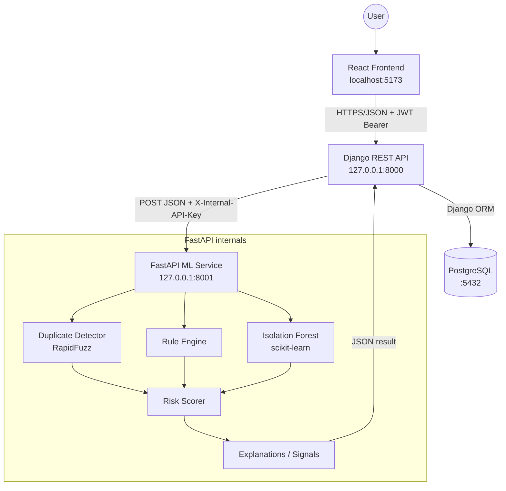
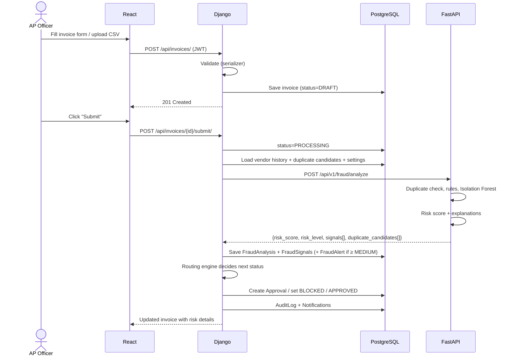

# System Architecture

> **Status:** ✅ Backend integration implemented and verified end-to-end in Phase 9. React frontend implemented in Phases 10–13; final integration in Phase 16.

## 1. Overview

The system has three running applications and one database, all on one Windows machine:

| Component | Port | Responsibility |
|---|---|---|
| **React frontend** (Vite dev server) | 5173 | User interface. Talks **only** to Django |
| **Django REST API** | 8000 | Main backend and **source of truth**: auth, business data, workflow, audit, reports |
| **FastAPI ML service** | 8001 | Stateless intelligence: duplicate detection, rules, Isolation Forest, risk scoring |
| **PostgreSQL** | 5432 | Persistent storage. **Only Django** connects to it |



## 2. Why this split?

- **Django** is good at data modelling, admin, authentication, permissions and transactional workflows.
- **FastAPI** is lightweight, fast, and validates input with Pydantic. It is a natural home for Python ML code. Keeping ML separate means:
  - The model loads **once** at FastAPI startup, not in every Django worker.
  - ML code can be developed, tested and restarted independently.
  - The ML service could later be scaled or replaced without touching business logic.
- **FastAPI is stateless.** It does not connect to PostgreSQL. Django sends everything the analysis needs: the invoice, the vendor's history, candidate invoices for duplicate comparison, and the current configuration (thresholds, weights, working hours). Data stays in one place, and FastAPI is easy to unit-test.

## 3. Django backend structure

```text
backend/
├── manage.py
├── requirements.txt
├── .env.example
├── config/                 # project settings, root URLs, WSGI/ASGI
├── common/                 # shared: exception handler, pagination, permissions base, utils
├── accounts/               # User, Role, JWT auth views, user management
├── vendors/                # Vendor, VendorBankAccount, vendor dashboard
├── invoices/               # Invoice, InvoiceItem, CSV/JSON import, invoice APIs
├── fraud/                  # FraudAnalysis, FraudSignal, FraudAlert, ML client, analysis service
├── approvals/              # Approval, Payment (simulated), routing engine, decision APIs
├── audit/                  # AuditLog model + audit service (append-only)
├── reports/                # analytics queries, CSV/PDF export
├── demo/                   # seed_data command: demo accounts, history, the 5 scenarios
├── notifications/          # Notification model + service
└── system_settings/        # SystemSetting key/value configuration
```

Each app follows the same layering:

```text
models.py        → database tables
serializers.py   → validation + JSON conversion
services.py      → business logic (the "brain"; views stay thin)
permissions.py   → role checks
views.py         → HTTP endpoints (DRF ViewSets / APIViews)
urls.py          → routes
tests/           → unit + API tests
```

> **Why a service layer?** Views only deal with HTTP. Services hold business rules, so the same logic can run from an API view, a management command (`seed_data`) or a test.

## 4. FastAPI ML service structure

```text
ml-service/
├── main.py                 # app factory, router registration, model loading at startup (lifespan)
├── config.py               # env vars (API key, model paths)
├── security.py             # X-Internal-API-Key check
├── errors.py               # same error JSON shape as Django
├── routers/                # health.py, duplicate.py, fraud.py (rules, anomaly, analyze), vendor.py, risk.py
├── services/
│   ├── duplicate_detector.py
│   ├── rule_engine.py
│   ├── feature_engineering.py   # build_features(): shared by training and serving
│   ├── anomaly_detector.py      # loads/holds the Isolation Forest + scaler, scores, explains
│   ├── vendor_analyzer.py
│   ├── risk_scorer.py
│   └── fraud_detector.py        # orchestrates duplicate + rules + ML + scoring (/fraud/analyze)
├── schemas/                # Pydantic request/response models
├── training/               # dataset.py (synthetic data), context.py (history replay), train.py
├── utils/                  # similarity.py, preprocessing.py
├── models/                 # isolation_forest.pkl, scaler.pkl, model_metadata.json (generated, git-ignored)
└── tests/
```

## 5. Communication

| From → To | Protocol | Auth | Format |
|---|---|---|---|
| React → Django | HTTP REST | `Authorization: Bearer <JWT access token>` | JSON (multipart for file upload) |
| Django → FastAPI | HTTP REST (`requests`, 10 s timeout) | `X-Internal-API-Key: <shared secret>` | JSON |
| Django → PostgreSQL | TCP (psycopg) | DB user/password from `.env` | SQL via ORM |

All URLs come from environment variables (`FASTAPI_URL`, `VITE_API_BASE_URL`). Nothing is hard-coded.

### Failure handling
If FastAPI is down or times out, Django **does not lose the invoice**. It:
1. Saves the invoice with `fraud_status = ANALYSIS_FAILED`.
2. Routes it to manual **Manager review**. This fails safe: never auto-approve an unanalysed invoice.
3. Logs the error and creates an audit entry (`FRAUD_ANALYSIS_FAILED`).
4. Lets a user retry via `POST /api/invoices/{id}/analyze/`.

The same fail-safe applies when FastAPI answers but its **ML model is not loaded**: rules and duplicate detection ran, but the invoice is never auto-approved. `GET /api/health/` reports both the database and the ML service (model loaded, version). The FastAPI call is made **outside** any database transaction (see approval-workflow.md §8.2).

## 6. Main request flow: submitting an invoice



## 7. Authentication architecture
See [authentication.md](authentication.md). In short: SimpleJWT issues a short-lived **access token** and a longer **refresh token**. React attaches the access token with an Axios interceptor and refreshes it when it expires. Every Django view checks both **authentication** and **role permission**. The frontend only *hides* UI. The backend *enforces* access.

## 8. Workflow architecture
See [approval-workflow.md](approval-workflow.md). Risk level → routing: LOW (auto/normal approval), MEDIUM (manager), HIGH (auditor), CRITICAL (blocked + investigation).

## 9. Cross-cutting concerns

| Concern | Approach |
|---|---|
| Errors | One JSON error shape `{success:false, error:{code,message,details}}` via a custom DRF exception handler and FastAPI exception handlers. No tracebacks exposed |
| Logging | Python `logging` to console + rotating file `backend/logs/app.log`. Never log passwords, tokens or full bank numbers |
| Audit | `audit.services.log_action()` is called from services for every important action |
| Config | `.env` for secrets/infrastructure. `SystemSetting` table for business rules editable by Admin |
| CORS | `django-cors-headers` allows only `http://localhost:5173` (from env) |

## 10. Deployment view
See [deployment.md](deployment.md). Everything runs natively on Windows. No Docker.
