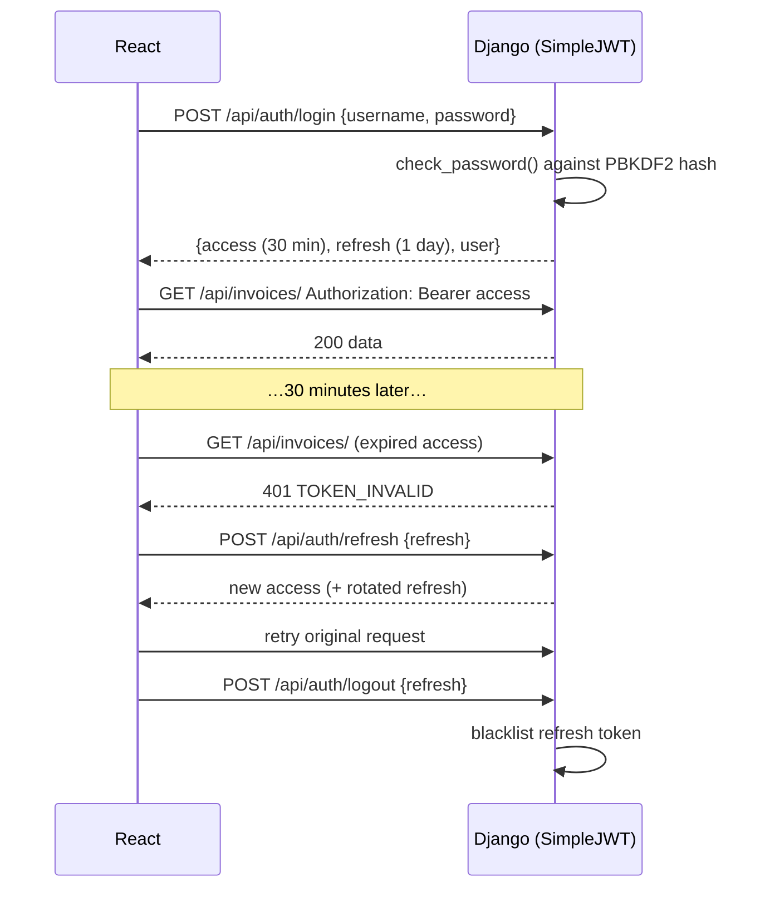

# Authentication & Authorisation

> **Status:** ✅ Backend implemented in Phase 3; frontend (§6) implemented in Phase 10 (see frontend.md §8).

## 1. Concepts (for the viva)
- **Authentication** answers *"who are you?"*: username + password → JWT.
- **Authorisation** answers *"what are you allowed to do?"*: role-based permission checks on **every** backend request.
- **JWT (JSON Web Token)** is a signed token with three base64 parts: `header.payload.signature`. The server can verify the signature without a database lookup. The payload holds `user_id`, `exp` (expiry), `jti` (token id) and `token_type`. The role is deliberately **not** in the token; see §5.3. JWTs are **signed, not encrypted**, so never put secrets in them.

## 2. Token flow



Configuration (`config/settings.py` via `.env`):
- `ACCESS_TOKEN_LIFETIME = 30 min`, `REFRESH_TOKEN_LIFETIME = 1 day`
- `ROTATE_REFRESH_TOKENS = True`, `BLACKLIST_AFTER_ROTATION = True` (uses `rest_framework_simplejwt.token_blacklist`)
- `SIGNING_KEY = JWT_SIGNING_KEY` from `.env`

### Token storage in the browser
The frontend keeps tokens in `localStorage` so a page refresh keeps the user logged in. **Trade-off:** `localStorage` can be read by injected JavaScript (XSS). Mitigations: React escapes output by default, we never use `dangerouslySetInnerHTML`, and access tokens are short-lived. A production system would use an `HttpOnly` cookie for the refresh token. This is documented as a limitation.

## 3. Roles
| Code | Name | Summary |
|---|---|---|
| `ADMIN` | Administrator | Everything, including users, settings, vendors |
| `AP_OFFICER` | Accounts Payable Officer | Creates, uploads and submits invoices. Views analysis |
| `MANAGER` | Manager | Reviews invoices assigned to them |
| `AUDITOR` | Auditor | Investigates suspicious invoices and alerts. Views audit logs. Exports reports |

## 4. Permission matrix
| Capability | ADMIN | AP_OFFICER | MANAGER | AUDITOR |
|---|:-:|:-:|:-:|:-:|
| Manage users & roles | ✔ | | | |
| Configure settings / thresholds | ✔ | | | |
| Create / edit vendors | ✔ | create only | | |
| Add vendor bank account | ✔ | | | |
| View vendors & vendor history | ✔ | ✔ | ✔ | ✔ |
| Create / upload / submit invoices | ✔ | ✔ | | |
| Edit / delete DRAFT invoice | ✔ | own only | | |
| View invoices | all | own | assigned + dept | all (read-only; changed in Phase 9 so auditors can compare and see vendor history) |
| View fraud analysis & signals | ✔ | ✔ | ✔ | ✔ |
| View fraud alerts | ✔ | ✔ (own invoices) | assigned | ✔ |
| View approval queues (`approvals.view`) | all | | own | own |
| Approve / reject / clarify | | | assigned | assigned |
| Escalate to auditor | | | ✔ | |
| Resolve alert (cleared / confirmed issue) | | | | ✔ |
| Simulate payment | ✔ | | | |
| View audit logs | ✔ | | | ✔ |
| Analytics | ✔ | | ✔ | ✔ |
| Export reports | ✔ | | invoice & approval | ✔ |

## 5. Backend enforcement (implemented)

### 5.1 Capabilities instead of hard-coded role checks
The matrix in §4 is stored **once**, as code, in `backend/accounts/capabilities.py`:
```python
ROLE_CAPABILITIES = {
    "ADMIN":      {..., "users.manage", "settings.manage", ...},
    "AP_OFFICER": {..., "invoices.create", "invoices.submit", ...},
    "MANAGER":    {..., "approvals.decide", "approvals.escalate", ...},
    "AUDITOR":    {..., "alerts.resolve", "audit.view", ...},
}
```
Views ask *"may this user do X?"* rather than *"is this user a Manager?"*:
```python
permission_classes = [HasCapability.of(Cap.USERS_MANAGE)]
```
**Why this matters (viva point):** if the business decides Auditors may also escalate, only one line in `capabilities.py` changes. No view code changes. The same list is sent to React by `/api/auth/me/`, so the UI and the API can never disagree.

### 5.2 Layers of protection
| Layer | Mechanism | File |
|---|---|---|
| Authentication | `JWTAuthentication` is the default for every view. `IsAuthenticated` is the default permission (secure by default) | `config/settings.py` |
| Capability check | `HasCapability.of(...)`. For ViewSets, `ActionCapabilityMixin` maps each action to capabilities, and **unmapped actions are denied** (fail closed) | `accounts/permissions.py` |
| Object-level scoping | `visible_invoices(user)` is the single rule for which invoices a user sees. **AP officer:** own invoices. **Manager:** invoices assigned to them, plus non-draft invoices of their department. **Auditor:** all (read-only; Phase 9). **Admin:** all. Everything else returns 404 | `invoices/selectors.py` (Phase 4) |
| Workflow rules | Services check "only the assignee can decide", "cannot approve own invoice" | `approvals/services.py` (Phase 9) |

### 5.3 Role is read from the database on every request
The JWT only contains `user_id` (plus expiry and token id). The role is **not** copied into the token. On each request the user is loaded from PostgreSQL and `user.role_code` decides access. Consequences:
- Changing a user's role takes effect on their very next request.
- Deactivating a user blocks them immediately (SimpleJWT rejects inactive users), and all their refresh tokens are blacklisted.

### 5.4 Endpoints
| Endpoint | Behaviour |
|---|---|
| `POST /api/auth/login/` | Returns `access`, `refresh`, and `user` (with its `permissions` list). Wrong username or password gives the same `401 INVALID_CREDENTIALS`. **Rate-limited to 10/min per IP** (`LOGIN_RATE_LIMIT`), which then returns `429 TOO_MANY_REQUESTS` |
| `POST /api/auth/refresh/` | Rotation: returns a new access **and** refresh token and blacklists the old refresh token. Reusing an old one gives `401 TOKEN_INVALID` |
| `POST /api/auth/logout/` | Blacklists the given refresh token (only your own) |
| `GET /api/auth/me/` | Current user + permissions |
| `POST /api/auth/change-password/` | Validates the old password and the password rules. Revokes every refresh token (logs out other devices) and returns fresh tokens for the current session |
| `/api/users/`, `/api/roles/` | Admin only (`users.manage`). No DELETE; use `POST /api/users/{id}/deactivate/` and `/activate/`. An Admin cannot deactivate themselves (`409 CANNOT_DEACTIVATE_SELF`) |

### 5.5 Settings (`config/settings.py` → `SIMPLE_JWT`)
| Setting | Value | Source |
|---|---|---|
| `ACCESS_TOKEN_LIFETIME` | 30 min | `JWT_ACCESS_MINUTES` |
| `REFRESH_TOKEN_LIFETIME` | 1 day | `JWT_REFRESH_DAYS` |
| `ROTATE_REFRESH_TOKENS` / `BLACKLIST_AFTER_ROTATION` | True / True | fixed |
| `SIGNING_KEY` | separate from `DJANGO_SECRET_KEY` | `JWT_SIGNING_KEY` |
| Blacklist storage | tables `token_blacklist_outstandingtoken`, `token_blacklist_blacklistedtoken` | app `rest_framework_simplejwt.token_blacklist` |

**Known limitation:** an *access* token stays valid until it expires (≤ 30 min) even after logout, because access tokens are checked by signature only (that is what makes JWT stateless). Deactivated users are still blocked immediately, because their user record is checked on every request.

### 5.6 Tests
| File | What it proves |
|---|---|
| `accounts/test_capabilities.py` | The matrix matches §4, only Admin manages users/settings, inactive or role-less users have no rights (no DB needed) |
| `accounts/test_auth_api.py` | Login, identical errors for wrong user/password, audit without passwords, rate limit, token rotation, blacklist on logout, deactivation lock-out, password change |
| `accounts/test_user_api.py` | 403 for non-admins on every user endpoint, audited role changes with old/new values, no deletes, no self-deactivation |

## 6. Frontend enforcement (UX only) ✅ Implemented (Phase 10)
- `<ProtectedRoute roles={["ADMIN","AUDITOR"]}>` hides pages.
- Sidebar items and buttons are shown based on `user.role`.
- **This is only for user experience.** If someone bypasses it (e.g. with Postman), the backend still returns 403/404.

## 7. Password security
- Django's PBKDF2-SHA256 with salt (hundreds of thousands of iterations).
- `AUTH_PASSWORD_VALIDATORS`: minimum length 8, not common, not entirely numeric, not similar to username.
- Login failures return a generic message and are logged (without the password).

## 8. Audit of auth events
`USER_LOGIN`, `USER_LOGIN_FAILED`, `USER_LOGOUT`, `PASSWORD_CHANGED`, `USER_CREATED`, `USER_DEACTIVATED`, `ROLE_CHANGED`.
