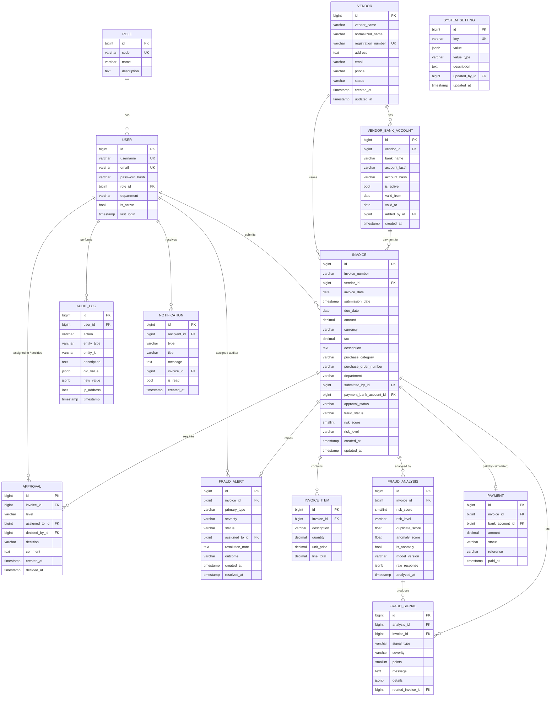

# Database Design

> **Status:** ✅ Implemented in Phase 2 as Django models and migrations. See §4 for what changed from the Phase 0 design.

Database: **PostgreSQL**, accessed only by Django through the ORM. All tables get an auto-increment `id` primary key (`BigAutoField`) unless stated otherwise. Most tables have `created_at` (auto on insert) and `updated_at` (auto on save).

## 1. ER diagram



## 2. Tables

### 2.1 `accounts_role`
| Field | Type | Constraints | Notes |
|---|---|---|---|
| code | varchar(20) | unique | `ADMIN`, `AP_OFFICER`, `MANAGER`, `AUDITOR` |
| name | varchar(50) | | Display name |
| description | text | blank | |

### 2.2 `accounts_user` (custom user, extends `AbstractUser`)
| Field | Type | Constraints | Notes |
|---|---|---|---|
| username | varchar(150) | unique | |
| email | varchar | unique | |
| password | varchar | | **PBKDF2-SHA256 hash** (Django default). Never plain text |
| role | FK → Role | PROTECT, nullable for superuser | |
| department | varchar(100) | blank | Used for department analytics |
| is_active | bool | default true | Deactivate instead of deleting (keeps audit history) |

> A custom user model must be defined **before the first migration**. This is why Phase 2 creates it first.

### 2.3 `vendors_vendor`
| Field | Type | Constraints | Notes |
|---|---|---|---|
| vendor_name | varchar(200) | indexed | As entered |
| normalized_name | varchar(200) | indexed | Lower-case, punctuation and legal suffixes ("corp", "ltd", "inc") removed. Used for fuzzy matching |
| registration_number | varchar(50) | unique, nullable | Company registration / tax ID |
| address, email, phone | | | |
| status | varchar(20) | choices | `ACTIVE`, `INACTIVE`, `UNDER_REVIEW`, `BLOCKED` |

### 2.4 `vendors_vendorbankaccount`
| Field | Type | Constraints | Notes |
|---|---|---|---|
| vendor | FK → Vendor | CASCADE | |
| bank_name | varchar(100) | | |
| account_last4 | varchar(4) | | Only thing ever displayed: `****1234` |
| account_hash | varchar(64) | indexed | HMAC-SHA256(full number, `BANK_HASH_KEY`). Lets us check "is this the same account?" without storing it |
| is_active | bool | | Only one active per vendor (enforced by partial unique constraint) |
| valid_from / valid_to | date | | History of changes |
| added_by | FK → User | SET_NULL | |

**Constraint:** `UniqueConstraint(fields=["vendor"], condition=Q(is_active=True), name="one_active_bank_account_per_vendor")`

> **Why not store the full account number?** The system only needs to (a) show a masked value and (b) detect a *change*. A keyed hash supports both, so a database leak does not expose account numbers. This follows the data-minimisation principle.

### 2.5 `invoices_invoice`
| Field | Type | Constraints | Notes |
|---|---|---|---|
| invoice_number | varchar(50) | indexed | |
| vendor | FK → Vendor | PROTECT | Vendors with invoices cannot be deleted |
| invoice_date | date | | Date on the invoice |
| submission_date | timestamptz | default now | When it was entered (used for unusual-time detection) |
| due_date | date | nullable, ≥ invoice_date | |
| amount | decimal(14,2) | > 0 (CheckConstraint) | |
| currency | varchar(3) | default `USD` | ISO 4217 |
| tax | decimal(14,2) | ≥ 0 | |
| description | text | | |
| purchase_category | varchar(50) | choices | e.g. SOFTWARE, HARDWARE, SERVICES, TRAVEL, OFFICE, OTHER |
| purchase_order_number | varchar(50) | blank | |
| department | varchar(100) | indexed | |
| submitted_by | FK → User | PROTECT | |
| payment_bank_account | FK → VendorBankAccount | SET_NULL, nullable | Bank account the invoice asks to be paid to |
| approval_status | varchar(20) | indexed, choices | `DRAFT, SUBMITTED, PROCESSING, UNDER_REVIEW, APPROVED, REJECTED, BLOCKED, PAID` |
| fraud_status | varchar(30) | choices | `NOT_ANALYZED, ANALYSIS_FAILED, NO_ISSUES, FLAGGED, REVIEWED_CLEARED, REVIEWED_CONFIRMED_ISSUE` |
| risk_score | smallint | 0–100, nullable | Denormalised copy of the latest analysis, for fast list/sort |
| risk_level | varchar(10) | indexed, nullable | LOW/MEDIUM/HIGH/CRITICAL |

**Constraints / indexes**
- `UniqueConstraint(vendor, invoice_number)`: an *exact* duplicate is rejected outright.
- `CheckConstraint(amount > 0)`, `CheckConstraint(tax >= 0)`
- Indexes: `(vendor, invoice_date)` for vendor history and duplicate candidates, `(approval_status)`, `(risk_level)`, `(submission_date)`.

### 2.6 `invoices_invoiceitem`
Line items (optional). `line_total = quantity × unit_price`. Validated in the serializer.

### 2.7 `fraud_fraudanalysis`
One row per analysis run (re-analysis keeps history). Stores `risk_score`, `risk_level`, `duplicate_score` (0–100), `anomaly_score` (0–1 from Isolation Forest), `is_anomaly`, `model_version`, and the full `raw_response` JSON for traceability.

### 2.8 `fraud_fraudsignal`
| Field | Notes |
|---|---|
| signal_type | `DUPLICATE, AMOUNT_ANOMALY, TIME_ANOMALY, THRESHOLD_PROXIMITY, SPLIT_PURCHASE, BANK_ACCOUNT_CHANGE, ROUND_AMOUNT, VENDOR_ANOMALY, ML_ANOMALY` |
| severity | `INFO, LOW, MEDIUM, HIGH` |
| points | Contribution to the risk score |
| message | Human-readable explanation, e.g. "94% similar to invoice INV-1001" |
| details | JSON with raw numbers (similarities, deltas) |
| related_invoice | FK → Invoice (for duplicates/splits), nullable |

### 2.9 `fraud_fraudalert`
Created when risk level ≥ MEDIUM. Fields: `primary_type`, `severity`, `status` (`OPEN, IN_REVIEW, RESOLVED, DISMISSED`), `assigned_to` (auditor), `outcome` (`CLEARED`, `CONFIRMED_ISSUE`, blank), `resolution_note`.
> *Design note:* `FraudAlert` is added beyond the original model list because the Fraud Alert dashboard needs per-alert status and assignee.

### 2.10 `approvals_approval`
| Field | Notes |
|---|---|
| level | `STANDARD`, `MANAGER`, `AUDITOR` |
| assigned_to | User who should decide |
| decided_by | User who actually decided |
| decision | `PENDING, APPROVED, REJECTED, CLARIFICATION_REQUESTED, ESCALATED` |
| comment | Required for REJECTED / CLARIFICATION / ESCALATED |

### 2.11 `approvals_payment` (simulated)
`status`: `SCHEDULED, PAID_SIMULATED, BLOCKED`. `reference` is a generated string like `SIM-PAY-000123`. **No real payment is ever made.**

### 2.12 `audit_auditlog`
Append-only. Fields: `user` (nullable for system actions), `action` (e.g. `INVOICE_CREATED`, `USER_LOGIN`), `entity_type`, `entity_id`, `description`, `old_value` (JSON), `new_value` (JSON), `ip_address`, `timestamp` (indexed). The API exposes **no** update/delete endpoints. The Django admin registers it read-only.

### 2.13 `notifications_notification`
`recipient`, `type` (`HIGH_RISK_INVOICE, DUPLICATE_DETECTED, APPROVAL_REQUIRED, INVOICE_REJECTED, INVOICE_APPROVED, PAYMENT_BLOCKED, VENDOR_RISK_ALERT`), `title`, `message`, `invoice` (nullable), `is_read`. Index `(recipient, is_read)`.

### 2.14 `system_settings_systemsetting`
Key/value business configuration editable by Admin (every change is audited).

| Key | Default | Meaning |
|---|---|---|
| `approval_threshold` | `10000` | Amount above which manager approval is required |
| `near_threshold_percent` | `10` | "Close to threshold" = within this % below it |
| `duplicate_threshold` | `80` | Combined similarity ≥ this ⇒ possible duplicate |
| `duplicate_weights` | `{"invoice_number":0.30,"vendor":0.25,"amount":0.20,"date":0.15,"description":0.10}` | |
| `duplicate_lookback_days` | `180` | How far back to look for candidates |
| `working_hours` | `{"start":"08:00","end":"19:00"}` | |
| `working_days` | `[0,1,2,3,4]` | Mon=0 … Sun=6 |
| `timezone` | `Asia/Kolkata` *(change to your locale)* | |
| `split_window_days` | `7` | Look-back window for split-purchase detection |
| `split_min_invoices` | `2` | Other invoices needed (plus current) to flag |
| `round_amount_base` | `1000` | Multiples of this count as "round" |
| `bank_change_window_days` | `30` | New bank account within N days ⇒ signal |
| `risk_level_thresholds` | `{"medium":30,"high":60,"critical":80}` | |
| `signal_weights` | see [risk-scoring.md](risk-scoring.md) | |
| `auto_approve_low_risk` | `true` | LOW risk & under threshold ⇒ auto-approve |

## 3. Data protection summary
- Passwords: hashed (PBKDF2).
- Bank accounts: only last 4 digits + keyed hash stored.
- Secrets: `.env` only.
- Audit log: append-only.
- Deleting users/vendors with history is blocked (`PROTECT`). Deactivate them instead.

## 4. Implementation notes (Phase 2)

### 4.1 Where each table lives
| App | Models | Migrations |
|---|---|---|
| `accounts` | `Role`, `User` (custom, `AUTH_USER_MODEL = "accounts.User"`) | `0001_initial`, `0002_seed_roles` (data) |
| `vendors` | `Vendor`, `VendorBankAccount` | `0001_initial` |
| `invoices` | `Invoice`, `InvoiceItem` | `0001_initial` |
| `fraud` | `FraudAnalysis`, `FraudSignal`, `FraudAlert` | `0001_initial` |
| `approvals` | `Approval`, `Payment` (simulated) | `0001_initial` |
| `audit` | `AuditLog` | `0001_initial` |
| `notifications` | `Notification` | `0001_initial` |
| `system_settings` | `SystemSetting` | `0001_initial`, `0002_seed_defaults` (data) |

Shared code: `common/models.py` (`TimeStampedModel`), `common/choices.py` (`RiskLevel`), `common/text.py` (`normalize_vendor_name`).

### 4.2 Additions and changes compared with the design
| Change | Reason |
|---|---|
| `FraudAlert.analysis` (FK) and `resolved_by` (FK) | Trace which analysis raised the alert and who resolved it |
| `FraudAlert` uses a FK to Invoice plus the partial unique constraint `one_open_alert_per_invoice`, instead of one-to-one | An invoice can be re-analysed after an alert is resolved, but it never has two open cases at once |
| Check constraint `resolved_alert_has_outcome` | A resolved alert must record the human decision |
| `Approval` partial unique constraint `one_pending_approval_per_invoice` | An invoice waits on exactly one reviewer at a time |
| `Payment.currency`, `Payment.created_at`, positive-amount check | Completeness |
| Check constraints `invoice_risk_score_max_100`, `analysis_risk_score_max_100`, item quantity > 0, unit price ≥ 0 | Data integrity at database level |
| Settings `ml_anomaly_threshold` and `signal_floors` | Values from machine-learning.md and risk-scoring.md are configurable, not hard-coded |
| `Notification.Type.CLARIFICATION_REQUESTED` | Needed by the workflow |
| `AuditLog.Action` enumerates about 30 actions, including `VENDOR_BANK_ACCOUNT_ADDED` / `_CHANGED` and `REPORT_EXPORTED` | One controlled vocabulary for reporting |

### 4.3 How the rules are enforced
| Rule | Where |
|---|---|
| Exact duplicate (vendor + invoice number) | DB unique constraint |
| amount > 0, tax ≥ 0, due ≥ invoice date | DB check constraints + `Invoice.clean()` for friendly messages |
| Invoice date not in the future, bank account belongs to vendor | `Invoice.clean()` (depends on "today" or on another table, so not a DB constraint) |
| Allowed status changes | `Invoice.ALLOWED_TRANSITIONS` + `transition_to()` |
| One active bank account per vendor | DB partial unique constraint |
| Bank numbers never stored | `vendors/services.py`: `add_bank_account()` stores last 4 digits + HMAC-SHA256 (`BANK_HASH_KEY`), closes the previous account, and writes a masked audit entry |
| Audit log is append-only | `AuditLog.save()` / `delete()` and queryset `update()` / `delete()` raise `AuditLogImmutableError`. The admin is read-only |
| Settings fall back to defaults | `system_settings/services.py`: `get_setting()` / `get_all_settings()` |

### 4.5 Deterministic ordering (fixed in Phase 4)
Every time-based default ordering has the id as a tie-breaker, e.g. `ordering = ["-created_at", "-id"]`.

**Why:** on Windows, Python's clock ticks in steps of roughly 1–15 ms, so two rows saved in quick succession can have *identical* timestamps. PostgreSQL may then return them in either order, and "latest analysis" or "current bank account" could be picked at random. This showed up as a test that passed on one run and failed on the next. IDs always increase, so ties cannot happen. The `0002_alter_*_options` migrations record this change.

### 4.4 Commands
```powershell
cd backend
.\venv\Scripts\Activate.ps1
python manage.py makemigrations      # only after changing models
python manage.py migrate             # apply to PostgreSQL
python manage.py showmigrations      # [X] = applied
python manage.py createsuperuser
python manage.py test                # model tests (needs the DB user to have CREATEDB)
```
