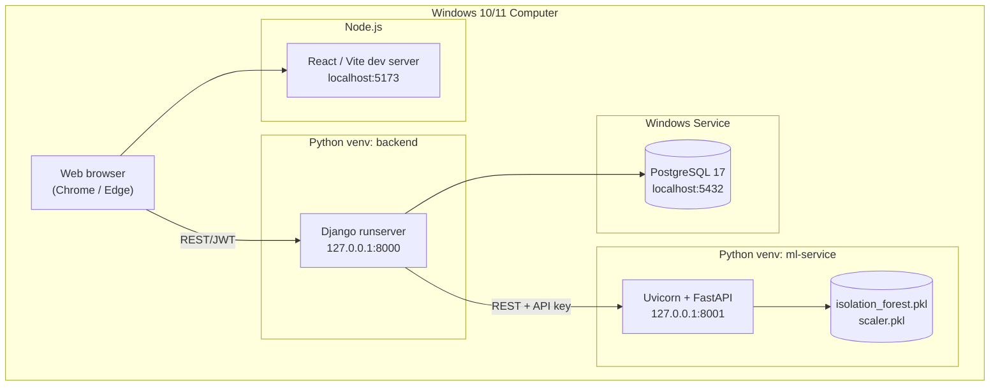

# Deployment (Windows, Local, No Docker)

> **Status:** ✅ Final (Phase 16). §2 (start order and `start_all.ps1`) was run end to end. §3 (production-like mode) is optional guidance that was **not** run in this project; the port and CORS notes were checked against the settings.

This project is deployed as **four native Windows processes on one computer**. No Docker, WSL, Kubernetes or cloud services are used.

## 1. Deployment diagram


## 2. Start order
1. PostgreSQL (Windows service `postgresql-x64-17`, starts automatically)
2. FastAPI (`uvicorn main:app --port 8001`)
3. Django (`python manage.py runserver 8000`)
4. React (`npm run dev`)

**One command (Phase 16):**
```powershell
powershell -ExecutionPolicy Bypass -File scripts\start_all.ps1                      # your database
powershell -ExecutionPolicy Bypass -File scripts\start_all.ps1 -Database expense_intelligence_demo -NoBrowser
```
It opens one window per service (ML service, Django, React), waits until each answers its health URL, then opens http://localhost:5173. Close a service by closing its window. `-Database` points Django at another database for that run (e.g. a separate demo database), without editing `.env`.

**All tests in one go:** `powershell -ExecutionPolicy Bypass -File scripts\run_tests.ps1` (add `-Live` for the five end-to-end tests; the ML service must be running).

## 3. "Production-like" local mode (optional, for the final demo)
| Component | Command |
|---|---|
| React | `npm run build` then `npm run preview -- --port 5173 --strictPort` (the optimised build; port 5173 because Django's CORS setting allows exactly `http://localhost:5173`) |
| Django | `python -m pip install waitress` then `python -m waitress --port=8000 config.wsgi:application` (Gunicorn does not run on Windows). The API needs no static files; the Django admin pages look unstyled under waitress unless a web server serves `staticfiles/` |
| FastAPI | `python -m uvicorn main:app --port 8001 --workers 2` |
| Settings | `DEBUG=False`, strong secrets, `ALLOWED_HOSTS` set, `python manage.py collectstatic` |

## 4. Security checklist before a demo
- [ ] `.env` files exist and are **not** committed (`git status` shows nothing sensitive)
- [ ] `DEBUG=False` if showing error behaviour
- [ ] Demo passwords are not reused real passwords (the `seed_data` accounts use a published demo password)
- [ ] Demo data lives in its own database if the real one must stay clean (`start_all.ps1 -Database …`)
- [ ] Only localhost addresses are bound

## 5. HTTPS settings (added in Phase 15)
The demo runs on plain `http://127.0.0.1`, so HTTPS hardening is **off** by default. If the application is ever served over HTTPS (for example behind IIS or nginx with a certificate), set in `backend/.env`:

| Variable | Effect |
|---|---|
| `HTTPS=True` | Redirect http → https, secure-only session and CSRF cookies, HSTS for `HSTS_SECONDS` (default 3600 = 1 hour) |
| `HSTS_SECONDS` | Raise (e.g. to 31536000 = 1 year) only after HTTPS works everywhere: browsers remember it and refuse plain http |
| `HSTS_INCLUDE_SUBDOMAINS=True` | Only if **every** subdomain is HTTPS |
| `BEHIND_PROXY=True` | When the proxy terminates TLS and forwards `X-Forwarded-Proto` |

`python manage.py check --deploy` with `DEBUG=False HTTPS=True` then reports only W005 (include subdomains) and W021 (preload): both are deliberate opt-ins, because they are hard to undo.
