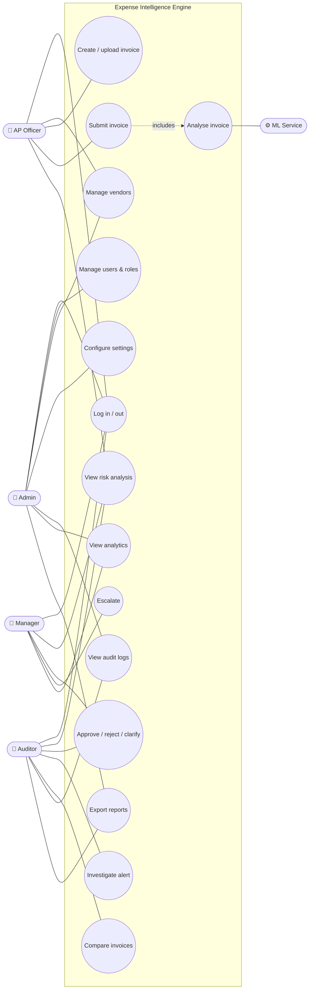
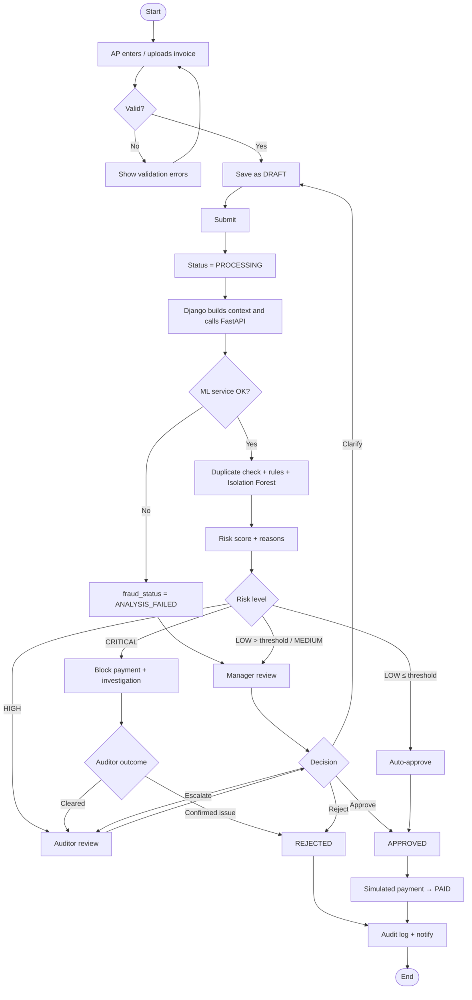
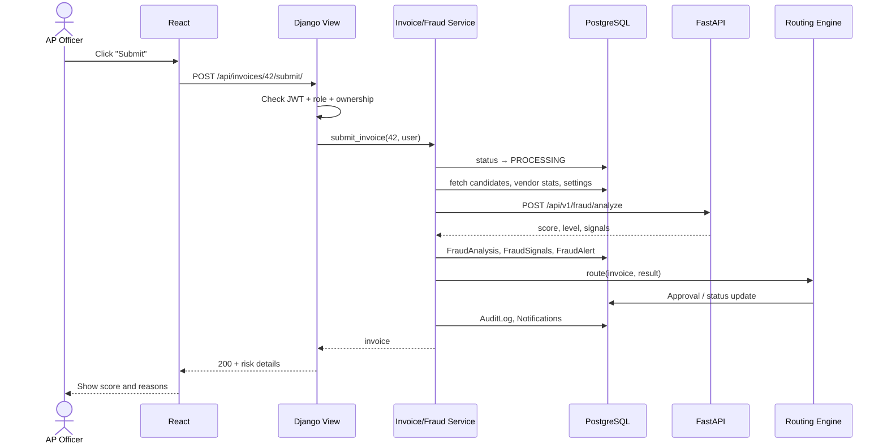
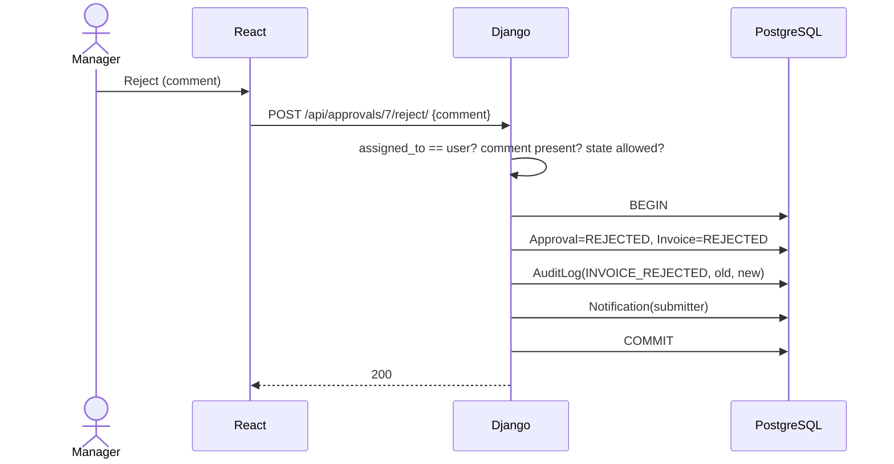
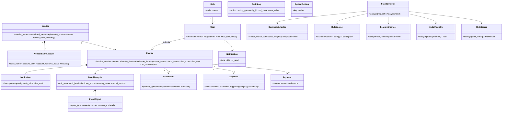
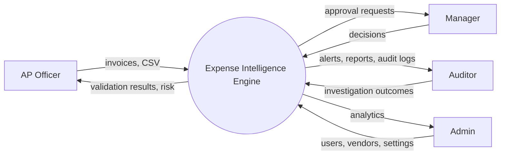
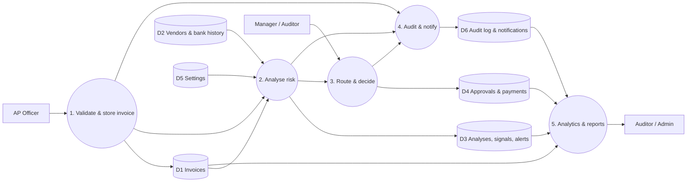

# Software Engineering Diagrams

> **Status:** ✅ Matches the finished system (Phase 16). All diagrams are Mermaid. They render on GitHub and in VS Code (with the "Markdown Preview Mermaid Support" extension). To export PNGs for your report, paste each diagram into https://mermaid.live and download.

## 1. Use case diagram
Mermaid has no native use-case notation, so actors and use cases are drawn as a flowchart.

## 2. Activity diagram: invoice lifecycle

## 3. Sequence diagram: fraud analysis

## 4. Sequence diagram: manager decision

## 5. Class diagram (main domain classes)

## 6. ER diagram
See [database.md §1](database.md#1-er-diagram).

## 7. System architecture diagram
See [architecture.md §1](architecture.md#1-overview).

## 8. Data flow diagram

### Level 0 (context)

### Level 1

## 9. Deployment diagram
See [deployment.md §1](deployment.md#1-deployment-diagram): one Windows computer running the React dev server, Django, FastAPI and PostgreSQL. No Docker.
