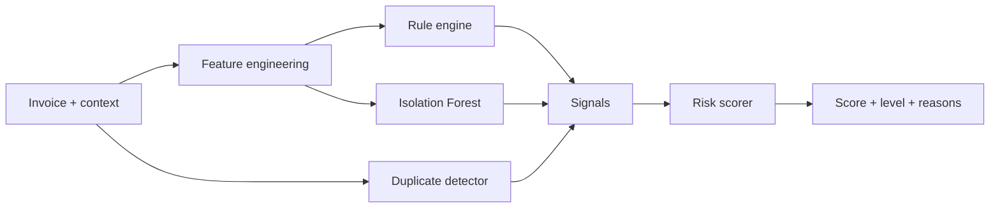

# Fraud / Anomaly Detection (Hybrid)

> **Status:** ✅ Rules, feature engineering and vendor analysis implemented in Phase 6 (`ml-service`); see §10 for the exact behaviour. ML signal added in Phase 7; points and the 0–100 risk score in Phase 8 (see risk-scoring.md).

> **Important:** The engine produces **risk indicators**. It never labels an invoice as fraud. Only a human reviewer can record the outcome `CONFIRMED_ISSUE`.

## 1. Why a hybrid approach?
| Technique | Strength | Weakness |
|---|---|---|
| **Rules** | Transparent, encode known policy (approval threshold, working hours) | Only catch patterns someone thought of |
| **ML (Isolation Forest)** | Finds *unusual combinations* nobody wrote a rule for | Harder to explain. Needs data. Can be wrong |
| **NLP / fuzzy matching** | Finds near-duplicates that exact matching misses | Needs threshold tuning |

Combining all three means the system does not depend on any single model, and every contribution is explainable.



## 2. Rules
All numbers come from `SystemSetting` and are sent by Django in `config`. Nothing is hard-coded.

| # | Rule | Condition | Signal type | Effect |
|---|---|---|---|---|
| R1 | Above approval threshold | `amount > approval_threshold` | *(routing, not risk)* | Django forces **at least Manager approval** |
| R2 | Possible duplicate | `duplicate_score ≥ duplicate_threshold` | `DUPLICATE` | Strength = duplicate_score/100. Creates duplicate alert |
| R3 | Bank account change | Invoice's payment account differs from the vendor's previous account used, **or** the active account was added within `bank_change_window_days` | `BANK_ACCOUNT_CHANGE` | High-priority review signal |
| R4 | Unusual submission time | Submission outside `working_hours` or on a day not in `working_days` (in the configured `timezone`) | `TIME_ANOMALY` | Weekend + night = strength 1.0. One of the two = 0.6 |
| R5 | Near approval threshold | `threshold × (1 − near_threshold_percent/100) ≤ amount ≤ threshold` | `THRESHOLD_PROXIMITY` | Strength grows as amount approaches the threshold |
| R6 | Potential split purchase | See §3 | `SPLIT_PURCHASE` | Labelled **"Potential Split Purchase"** |
| R7 | Round amount | `amount % round_amount_base == 0` and `amount ≥ round_amount_base` | `ROUND_AMOUNT` | Weak signal only |
| R8 | Amount deviation | `|amount − vendor_avg| / vendor_std > 3` (vendor has ≥ 5 invoices) | `AMOUNT_ANOMALY` | Strength scales with z-score (capped) |
| R9 | Vendor anomaly | Vendor has prior open/confirmed alerts, is new (< 30 days), or invoice frequency spike (≥ 3× normal) | `VENDOR_ANOMALY` | |
| ML | Isolation Forest anomaly | Normalised anomaly score ≥ 0.6 | `ML_ANOMALY` | Strength = anomaly score |

## 3. Split-purchase detection (R6)
**Pattern:** a purchase is divided into several smaller invoices so that each one stays below the approval threshold.

```text
Approval threshold = 10,000
Invoice A = 9,900   (Sep 1)
Invoice B = 9,700   (Sep 3)
Invoice C = 9,800   (Sep 4)    ← current invoice
Combined = 29,400 → would have required manager approval
```

**Algorithm**
1. From the candidates Django sent, keep invoices with the **same vendor** within `split_window_days` (default 7) of the current invoice.
2. Keep those whose amount is **below the threshold and within the near-threshold band** (or ≥ 50% of the threshold).
3. If at least `split_min_invoices` (default 2) remain **and** the current invoice also qualifies → signal.
4. Strength is boosted by: same department (+), similar description (token similarity ≥ 0.7) (+), and combined total > threshold (+).

**Output message:** `"Potential Split Purchase: 3 invoices from ACME Corp within 4 days (9,900 + 9,700 + 9,800 = 29,400), each below the 10,000 approval threshold."` The related invoice IDs are listed in `details`.

## 4. Unusual time detection (R4)
Features derived from `submission_date` (converted to the configured timezone):
| Feature | Example (Sunday 02:17) |
|---|---|
| `submission_hour` | 2 |
| `day_of_week` | 6 |
| `is_weekend` | 1 |
| `is_outside_business_hours` | 1 |

Working hours and days are configurable, so a company with Saturday working can change `working_days`.

## 5. Round amounts (R7)
`5000`, `10000`, `20000` and `50000` are more common in fabricated invoices, but they are also very common in legitimate ones (retainers, subscriptions). This signal therefore has the **lowest weight** and never triggers review on its own.

## 6. Bank account change (R3)
Using stored hashes only:
- The vendor's active account `created_at` is within `bank_change_window_days` → *"Vendor bank account changed 12 days ago"*.
- The invoice's `payment_bank_account` differs from the account used on the vendor's previous paid invoice → *"Payment account differs from historical record (\*\*\*\*4821 → \*\*\*\*9930)"*.

This is one of the most common real-world payment-redirection frauds, so it carries a high weight.

## 7. Vendor-level analysis
`POST /api/v1/vendor/analyze` summarises vendor risk for the Vendor dashboard: bank changes, invoice-frequency spikes, share of invoices near the threshold, and duplicate/alert counts.

## 8. Output
Every rule that fires returns:
```json
{ "type": "THRESHOLD_PROXIMITY", "strength": 0.9, "severity": "MEDIUM",
  "message": "Amount is 1.0% below the approval threshold (10,000)",
  "details": { "amount": 9900, "threshold": 10000, "gap_percent": 1.0 } }
```
The **risk scorer** converts strengths to points. See [risk-scoring.md](risk-scoring.md).

## 9. Implementation location
- `ml-service/services/feature_engineering.py`: time features, deviations, gaps, counts.
- `ml-service/services/rule_engine.py`: one small function per rule, each returning `Signal | None`.
- `ml-service/services/fraud_detector.py`: orchestrates duplicate + rules + ML → risk scorer.

## 10. Implementation (Phase 6)

### 10.1 Files
| File | Role |
|---|---|
| `ml-service/schemas/fraud.py` | Contract: `AnalysedInvoice`, `VendorContext`, `BankContext`, `HistoryInvoice`, `RuleConfig`, `Signal` |
| `ml-service/services/feature_engineering.py` | `build_features()`: 18 named features in a fixed order, reused by the model in Phase 7 |
| `ml-service/services/rule_engine.py` | One function per rule + `evaluate()` |
| `ml-service/services/vendor_analyzer.py` | Vendor-level patterns |
| `ml-service/routers/fraud.py`, `routers/vendor.py` | `POST /api/v1/fraud/rules`, `POST /api/v1/vendor/analyze` |

### 10.2 What Django sends (and why)
FastAPI never reads the database, so Django sends the facts it already knows:

| Object | Contents |
|---|---|
| `invoice` | Invoice fields + `submission_datetime` (**must include a timezone offset**) + `department` |
| `vendor_context` | Statistics from the vendor's *earlier* invoices: count, average, standard deviation, company average/std, invoices in the last 30 days, normal monthly count, days since previous invoice, vendor age, status, open alerts, confirmed issues |
| `bank` | **Masked** accounts only: current `****4821`, its age in days, previous `****1111`, "differs from last paid invoice" |
| `recent_vendor_invoices` | Same vendor, recent weeks (for split-purchase and same-day checks) |
| `config` | The Admin settings (threshold, band, working hours/days, timezone, split window, …). Defaults equal Django's defaults |

### 10.3 Rules as implemented
| Rule | Fires when | Strength | Severity |
|---|---|---|---|
| R1 routing | amount **>** threshold | — (routing hint `above_approval_threshold`) | — |
| R2 duplicate | duplicate score ≥ `duplicate_threshold` | score / 100 | HIGH |
| R3 bank change | previous account exists **and** current account age ≤ `bank_change_window_days`; or payment account ≠ last paid account | 1.0 | HIGH |
| R4 time | outside `[start, end)` **or** not a working day (in the configured timezone) | 1.0 both / 0.6 one | MEDIUM / LOW |
| R5 threshold | `threshold × (1 − band%) ≤ amount ≤ threshold` | 1 − gap%/band (min 0.1) | MEDIUM if ≥ 0.5 |
| R6 split | current invoice **and** ≥ `split_min_invoices` others from the same vendor within `split_window_days`, each between 50% and 100% of the threshold | 0.6 + 0.15 same dept + 0.15 similar descriptions + 0.10 total > threshold | HIGH if ≥ 0.85 |
| R7 round | amount ≥ base and a multiple of `round_amount_base` | 1.0 | INFO |
| R8 amount | ≥ 5 vendor invoices: z > 3 vs vendor (else vs company). If std ≈ 0: amount ≥ 2× average | 0.5 at 3σ → 1.0 at 6σ (ratio case 0.8) | HIGH if ≥ 0.8 |
| R9 vendor | confirmed issues (1.0), frequency spike ≥ 3× normal and ≥ 3 invoices (0.7), status UNDER_REVIEW or open alerts (0.6), vendor < 30 days old (0.5) | strongest reason | HIGH ≥ 0.9, MEDIUM ≥ 0.6 |

Messages show the **true** values. For example, `Amount 6,050.00 is 19.4σ above this vendor's average`, even though the ML *feature* caps z at 10 so one extreme value cannot dominate the model.

### 10.4 Vendor analysis (`/api/v1/vendor/analyze`)
Indicators, strongest first: bank change (R3), vendor anomaly (R9), **≥ 30% of recent invoices just below the threshold**, **split-purchase clusters**, **≥ 50% round amounts** (≥ 5 invoices). The same rule functions are reused, so there is no second implementation to keep in sync.

### 10.5 Verified examples (live service, default settings, Asia/Kolkata)
| Scenario | Signals |
|---|---|
| Normal invoice, Tuesday 11:00, 1,200 (vendor avg 1,100) | none |
| Sunday 02:17, 6,050 (vendor avg 1,200, std 250) | TIME_ANOMALY 1.0 · AMOUNT_ANOMALY 1.0 |
| 9,800 after 9,900 and 9,700 in 3 days, same dept | THRESHOLD_PROXIMITY 0.8 · SPLIT_PURCHASE 1.0 |
| Vendor account changed 12 days ago | BANK_ACCOUNT_CHANGE 1.0 (`****1111 → ****4821`) |
| 5,000, 94% similar to INV-1001 | DUPLICATE 0.94 · ROUND_AMOUNT (INFO) |

Tests: `ml-service/tests/test_rules.py`, `test_feature_engineering.py`, `test_fraud_api.py` (64 tests, including every boundary: 07:59 fires / 08:00 does not; 3.0σ silent / 3.01σ fires; day 30 in window / day 31 not).
