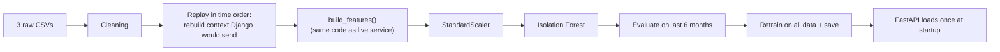

# Machine Learning: Isolation Forest Pipeline

> **Status:** ✅ Implemented and evaluated in Phase 7. All numbers below come from `data/processed/evaluation_report.json` for model `iforest-20260924-025523` (dataset seed 42). Re-running the two scripts reproduces them.

> 🎓 **Synthetic data notice:** The dataset is **synthetically generated** for academic demonstration. It does not represent real corporate fraud data, and results on it do not prove performance on real invoices. The model outputs an **anomaly score**, not proof of fraud.

## 1. Why anomaly detection?
Real labelled fraud data is rare, confidential and heavily imbalanced (often < 1% positives). **Supervised** classification needs many labelled examples of fraud. **Unsupervised anomaly detection** instead learns what *normal* invoices look like and flags invoices that are unusual. This fits the problem: suspicious invoices are, by nature, unusual.

## 2. Why Isolation Forest?
- **Idea:** anomalies are *few and different*, so they are **easier to isolate**. The algorithm builds many random trees. Each tree repeatedly picks a random feature and a random split value. An unusual point gets isolated after only a few splits (a **short path length**). A normal point needs many splits.
- **Anomaly score:** based on the average path length across trees. Shorter path = more anomalous.
- **Advantages:** no labels needed, fast, handles many features, few hyperparameters, available in scikit-learn.
- **Alternatives considered:** One-Class SVM (slow, sensitive to scaling and kernel choice), Local Outlier Factor (distance-based and slower; needs `novelty=True` to score new invoices), Autoencoder (too complex for the data size and harder to explain).

## 3. Dataset
Generated by `scripts/generate_dataset.py` → `ml-service/training/dataset.py` (seed 42). It writes **three tables shaped like the Django database**:

| File (`data/raw/`) | Rows | Contents |
|---|---|---|
| `synthetic_vendors.csv` | 60 | vendor_id, name, category, created_date |
| `synthetic_bank_accounts.csv` | 85 | vendor_id, account_id, valid_from (history of accounts) |
| `synthetic_invoices.csv` | 5,420 | invoice fields + `is_injected_anomaly`, `anomaly_type`, `anomaly_group` |

**Normal behaviour.** Each vendor has its own typical amount (log-normal, median 150–25,000), spread, invoice frequency (1–8 per month), departments and description vocabulary. Invoices are entered 0–3 days after the invoice date, on working days, around 13:00 ± 2.3 h. Period: 18 months (March 2025 to August 2026).

**Deliberate realism (noise in *normal* data).** 1.5% of legitimate invoices are entered late in the evening or on a Saturday, 10% of vendors legitimately change bank accounts, and 15% of vendors bill round retainers. Without this noise, anomalies would be trivially separable and the metrics would be meaningless.

**Injected anomalies (labels, 259 rows = 4.8%)**

| Type | Rows | How it is generated |
|---|---|---|
| duplicate | 62 | copy of an earlier invoice: same amount, date + 0–6 days, number disguised (`AT5-1034` → `AT51034`, `…103S`, lower-case, `-A` suffix), description slightly changed |
| split_purchase | 63 (21 groups × 3) | 3 invoices of 9,000–9,990 from one vendor within 5 days, same department and description |
| off_hours | 41 | normal amount, submitted at night and/or at the weekend |
| amount_spike | 41 | 5–12 × the vendor's typical amount |
| bank_change | 21 | vendor bank account changes, then an invoice of 1.5–3 × typical follows within 8 days |
| threshold_hugging | 31 | single invoices of 9,500–9,999 from vendors whose typical amount is < 3,000 |

**Data-quality problems (for the cleaning step, not fraud labels):** 5 exact copies of rows (export glitch), 1 missing amount, 1 negative amount, 1 unreadable timestamp.

> The labels are used **only for evaluation**, never for training. This keeps the model unsupervised.

## 4. Pipeline



### 4.1 Cleaning (`ml-service/utils/preprocessing.py`)
| Check | Rows removed |
|---|---|
| Missing required values (ids, vendor, number, dates, amount) | 0 |
| Invalid amount (missing, non-numeric or ≤ 0) | 2 |
| Unparseable invoice date / submission time | 1 |
| Exact duplicate rows (all columns except id) | 5 |
| **Rows in → out** | **5,420 → 5,412** |

Exact duplicate *rows* are data errors. They are different from the business duplicates (near-identical *invoices*) that the duplicate detector looks for. Cleaning never removes a labelled anomaly (this is tested).

### 4.2 Rebuilding context (`ml-service/training/context.py`)
The live service receives context from Django (vendor statistics, bank status, recent invoices, duplicate score). For training, the pipeline **replays invoices in submission order** and computes, for each one, exactly that context using **only earlier invoices**:
- vendor count / mean / std (Welford running statistics), company mean / std, invoices in the last 30 days, normal monthly rate, days since the previous invoice, vendor age;
- the bank account active at submission time and the previous one (masked);
- the best duplicate score against the vendor's invoices of the last 180 days (the real duplicate detector);
- then it calls **the same `build_features()` as the live service**.

This rules out training/serving skew by construction and prevents look-ahead leakage (tested: a vendor's first invoice always has `amount_dev_vendor = 0` and `duplicate_similarity = 0`). Runtime: about 3 s for 5,412 invoices.

### 4.3 Features
`build_features()` produces 18 features (see [fraud-detection.md §10](fraud-detection.md)). The model uses **13** of them:

| Used by the model | Why |
|---|---|
| `log_amount`, `amount_dev_vendor`, `amount_dev_company` | size of the amount, absolute and relative to normal |
| `is_weekend`, `is_outside_hours`, `hour_sin`, `hour_cos` | when it was submitted (cyclical encoding keeps 23:30 close to 00:30) |
| `vendor_invoice_frequency`, `same_day_invoice_count` | how busy the vendor is |
| `duplicate_similarity`, `threshold_distance`, `round_amount_flag`, `bank_account_changed` | relational and policy features |

**Left out (decided by experiment, §4.7):** raw `submission_hour` and `day_of_week` (redundant with the cyclical encoding) and `days_since_previous_invoice` (every vendor's first invoice has the maximum gap, which added noise). No vendor ID is used; vendor behaviour enters through the deviation features.

### 4.4 Scaling
Isolation Forest is tree-based and in principle **scale-invariant**. A `StandardScaler` is still fitted because the scaled values are z-scores, which the service uses to **explain** which features were most unusual.

### 4.5 Training (`ml-service/training/train.py`)
```python
IsolationForest(n_estimators=200, max_samples="auto", contamination=0.05, random_state=42)
```
`contamination=0.05` is the assumed share of unusual invoices. Training data = the 13-feature matrix (unsupervised; labels are not passed).

### 4.6 Anomaly score (0–1)
scikit-learn's `score_samples` returns *lower = more abnormal*, so `raw = −score_samples(x)`. It is mapped to 0–1 with three calibration points taken from the training data:

| Training raw score | Anomaly score |
|---|---|
| median | 0.0 |
| 95th percentile (the model's own contamination boundary) | **0.6** (= default `ml_anomaly_threshold`) |
| maximum | 1.0 |

Linear in between and capped at 1.0. **Meaning of 0.6:** "among the most unusual 5% of the invoices the model learned from." An earlier version mapped the 95th percentile to 0.6 and extrapolated linearly. That made most anomalies saturate at 1.00, so a Sunday-night invoice and a Sunday-night invoice with a 9× amount looked the same. The three-point scale keeps them apart (0.89 vs 1.00) and does not change any decision at 0.6.

### 4.7 Evaluation

**Method.** Time-based split: fit on the first 12 months (3,640 invoices), test on the **last 6 months (1,772 invoices, 88 anomalies)**. The model never sees the test months. The served model is then retrained on all 5,412 invoices.

**Hold-out results (threshold 0.6):**

| Metric | Value |
|---|---|
| Precision | **0.417** |
| Recall | **0.284** |
| F1-score | **0.338** |
| ROC-AUC | **0.887** |
| Average precision (PR-AUC) | 0.372 (a random model scores ≈ 0.05, the anomaly rate) |
| Invoices flagged | 3.4% |

Confusion matrix (hold-out): TP 25 · FP 35 · FN 63 · TN 1,649.

**Recall by anomaly type (hold-out):**

| Type | In hold-out | Recall |
|---|---|---|
| off_hours | 10 | **0.90** |
| amount_spike | 14 | **0.57** |
| duplicate | 22 | 0.18 |
| bank_change | 7 | 0.14 |
| threshold_hugging | 11 | 0.09 |
| split_purchase | 24 | 0.08 |

**Feature-set experiment (same split):**

| Features | ROC-AUC | Avg. precision | F1 |
|---|---|---|---|
| all 18 | 0.857 | 0.340 | 0.29 |
| **13 (chosen)** | **0.900** | **0.380** | 0.31 |
| 13 + days since previous invoice | 0.880 | 0.366 | 0.34 |

(The experiment was run before the dirty-row fix to the generator, which is why the chosen set shows 0.900 here and 0.887 in the final run.)

**Interpretation (important for the viva).**
- ROC-AUC 0.89 means the model **ranks** unusual invoices well above normal ones.
- It is strong on anomalies that make a *single invoice* look odd (time, amount) and weak on *relational* patterns: a duplicate or a split purchase looks perfectly normal on its own. It is only suspicious in relation to *other* invoices.
- This is exactly why the system is **hybrid**: the duplicate detector (R2) and rules R3/R5/R6 are built for the relational patterns. The ML model is one signal among several, never the whole decision.
- Precision 0.42 means that more than half of ML-only flags are legitimate unusual invoices. That is acceptable because every flag goes to a human with an explanation, and the ML signal carries at most 15 of the risk-score points (Phase 8).

In-sample figures (all data, for reference only; optimistic by construction): precision 0.369, recall 0.386, F1 0.377, ROC-AUC 0.904.

### 4.8 Saving
`scripts/train_model.py` writes:
```text
ml-service/models/isolation_forest.pkl     (joblib)
ml-service/models/scaler.pkl               (joblib)
ml-service/models/model_metadata.json      feature order, hyperparameters, calibration, threshold,
                                           dataset hash, hold-out + in-sample metrics, version
data/processed/evaluation_report.json      metrics, cleaning report, split
data/processed/features.csv                every invoice with its 18 features (for analysis/plots)
```
**Git policy:** `*.pkl`, the metadata JSON and the data files are git-ignored. They are regenerated in seconds by the two scripts, which keeps the repository small and shows the model is reproducible. For a demo machine without the training step, you may commit the model files deliberately with `git add -f`.

### 4.9 Serving (`ml-service/services/anomaly_detector.py`)
- Loaded **once** at FastAPI startup (lifespan), never per request. `/health` shows `model_loaded` and `model_version`.
- The feature order comes from the metadata. If the metadata asks for a feature the code no longer produces, the model is **refused** instead of silently mis-scoring.
- If the files are missing, the service still starts. Rules and duplicate detection keep working, and `POST /api/v1/fraud/anomaly` answers `503` with instructions.
- The threshold can be overridden per request via `config.ml_anomaly_threshold` (the Admin setting).

## 5. Explaining the ML signal
The explanation lists up to 3 features whose scaled value is ≥ 2 standard deviations from normal, translated into plain English. Features that would not help a reviewer are skipped (e.g. an unusually *low* amount). Values that hit the ±10σ cap are shown as "more than 10σ". Example output from the live service:
> "Unusual combination of features (anomaly score 1.00): submitted on a non-working day; submitted outside working hours (02:17); amount is more than 10σ above the vendor average"

## 6. How to run
```powershell
# from the project root
ml-service\venv\Scripts\python.exe scripts\generate_dataset.py   # ~1 s → data/raw/
ml-service\venv\Scripts\python.exe scripts\train_model.py        # ~10 s → ml-service/models/ + data/processed/
# then (re)start the ML service so it loads the new model
```

## 7. Limitations
- The synthetic data reflects the assumptions written in `training/dataset.py`. Real invoices would differ.
- `contamination=0.05` is an assumption about how common unusual invoices are.
- Weak on relational fraud patterns by design (see §4.7). The rules and duplicate detector cover them (measured in §8).
- Sensitive to submission time: a legitimate 20:30 weekday entry scored 0.75. Companies with shift work should adjust `working_hours` and retrain.
- Behaviour drifts over time, so the model should be retrained periodically on recent normal invoices.
- An anomaly is not fraud. Many unusual invoices (year-end purchases, one-off projects) are legitimate.

## 8. Hybrid evaluation (Phase 16)
`scripts/evaluate_hybrid.py` answers “what does each part contribute?” on the same hold-out as §4.7:
- invoices are replayed in submission order with `training/context.py` (each one only sees earlier invoices);
- a model is fitted on the earlier months only (the shipped model saw all data, so it is not used here);
- every hold-out invoice goes through the real `services/fraud_detector.analyze()`;
- “detected” = risk MEDIUM or higher, i.e. sent to a person.

```powershell
ml-service\venv\Scripts\python.exe scripts\evaluate_hybrid.py     # ~40 s -> data/processed/hybrid_evaluation.json
```

| Detector | Precision | Recall | F1 | Sent to review |
|---|---|---|---|---|
| Isolation Forest only | 0.417 | 0.284 | 0.338 | 3.4% |
| Rules + duplicate detector only | 0.380 | 0.614 | 0.470 | 8.0% |
| **Hybrid** | **0.400** | **0.682** | **0.504** | 8.5% |

| Anomaly type (count) | ML only | Rules only | Hybrid |
|---|---|---|---|
| bank_change (7) | 0.14 | 1.00 | 1.00 |
| duplicate (22) | 0.18 | 0.82 | 0.82 |
| amount_spike (14) | 0.57 | 0.79 | 0.79 |
| off_hours (10) | 0.90 | 0.10 | 0.60 |
| split_purchase (24) | 0.08 | 0.58 | 0.58 |
| threshold_hugging (11) | 0.09 | 0.27 | 0.36 |

The ML-only row reproduces §4.7 exactly, which confirms the replay. The first run of this experiment led to the single-signal floors described in risk-scoring.md §10. To keep training and evaluation identical, `ContextBuilder` gained `context_for()` and `record()`; the rebuilt features were checked to be identical for all 5,412 invoices.
